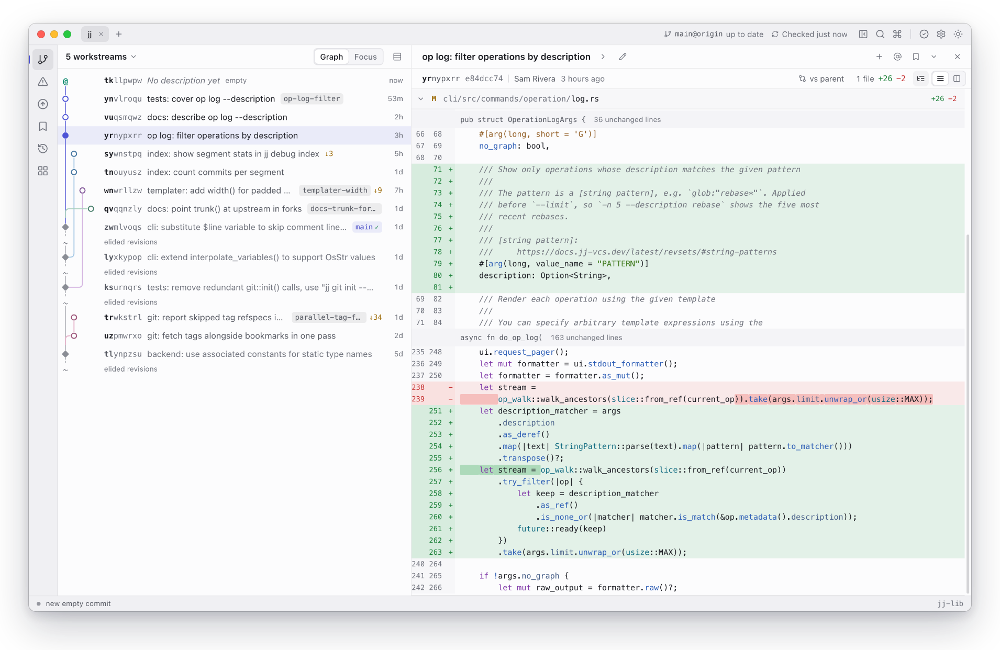

# Jiji

A desktop workbench for [Jujutsu](https://github.com/jj-vcs/jj) (`jj`) repositories.

<picture>
  <source media="(prefers-color-scheme: dark)" srcset="docs/images/workbench-dark.png">
  
</picture>

**[Download for macOS](https://github.com/scullionw/jiji/releases/latest/download/Jiji_darwin_aarch64.dmg)** (Apple Silicon, signed and notarized) · [jijiworkbench.com](https://jijiworkbench.com) · [Changelog](CHANGELOG.md)

Jiji puts jj's model on screen: the change graph, the diff of whatever you
select, and the operation log that makes every rewrite undoable. It is built
on jj-lib, so it reads your repo and your `jj` config (revset aliases,
`immutable_heads()`, merge tools) exactly the way the CLI does, and it keeps
up with whatever you do in a terminal alongside it. It is a native app: one
Rust program, drawn with [GPUI](https://www.gpui.rs), with no web view.

## What it does

- **Read history.** A dense graph of your stacks on trunk, lenses for
  your work, your team's bookmarks, or any revset, and a keyboard-driven
  command palette.
- **Review diffs.** Unified or split, syntax-highlighted, with a file
  tree, combined diffs across a stack, a change's evolution
  (`jj evolog`), and line annotation (`jj file annotate`).
- **Rewrite directly.** Describe, new, edit, squash, split down to single
  lines, absorb, abandon, revert, and drag a change onto a new parent to
  rebase it. Each action is one jj operation: undo it from the status bar,
  or restore any point in the operation log.
- **Resolve conflicts.** Conflicts render as their merge structure, side by
  side against the base. Take a side or open your merge tool.
- **Publish stacks.** Push a stack as one GitHub PR per change (stacks made
  with [jjpr](https://github.com/michaeldhopkins/jjpr) are recognized), follow checks
  and reviews, land one round, or let auto-land merge the whole stack.
- **Use the terminal too.** The `jiji` CLI runs the same stack engine:
  `jiji status`, `jiji publish`, `jiji land`, `jiji watch`. See
  [the CLI guide](docs/cli.md).

Open a plain Git repository and Jiji offers to set jj up in it, the way
`jj git init --colocate` does. Git keeps working alongside it.

## Install

Download the DMG above. Jiji updates itself: a new version downloads in the
background and waits for you to click "Restart to update".

- macOS on Apple Silicon only for now. Linux and Windows builds aren't
  available yet.
- Intel Macs can run [0.5.0](https://github.com/scullionw/jiji/releases/tag/app-v0.5.0),
  the last build made for them.
- Supported on the current macOS release and the one before it. Older
  systems back to macOS 12 can open it, untested.
- `git` must be on your `PATH` for fetch and push, as with `jj` itself.
- The `jj` CLI is optional. Jiji embeds jj-lib 0.45, so repositories and
  config stay compatible with `jj` 0.45.

### Command line

Install the `jiji` command from the app (command palette: **Install jiji
command-line tools**), or build it without the desktop app:

```bash
cargo install --path crates/jiji-cli --locked
```

```bash
jiji .                   # Open this repository in the app
jiji stacks              # Published stacks; --all includes local work
jiji status              # Current stack, PRs, and landing readiness
jiji publish --dry-run   # Preview pushes and PR updates
jiji publish             # Push and create/update the stack's PRs
jiji land                # Land one round and reconcile merged work
jiji watch               # Auto-land until finished; Ctrl-C stops safely
```

Every stack command takes `-R PATH`, `--json`, and an explicit head
bookmark. See [docs/cli.md](docs/cli.md) for authentication, review
commands, hidden work, dry runs, and exit codes.

## Network and privacy

Jiji has no telemetry or analytics. It talks to the network for:

- **Your Git remotes.** A `git fetch` when you open a repository, then in
  the background every 15 minutes (adjustable in Settings, or off), and
  pushes when you ask for them.
- **GitHub's API.** Only for publishing and PR features, using a token you
  provide or `gh auth token`. Tokens live in the macOS Keychain.
- **Updates.** A check against this repository's GitHub Releases.
- **Licensing.** Only if you enter a license key: validation with
  [Polar](https://polar.sh), at most once a day.

## Status

Jiji is alpha software. It is meant for people who already know `jj` well
enough to sanity-check what a GUI does before trusting it with important
work. Every mutation goes through jj's operation log, so `jj op log` and
`jj undo` work on anything Jiji did.

## Related projects

jj has a growing set of front ends: [gg](https://github.com/gulbanana/gg)
(desktop), [jjui](https://github.com/idursun/jjui) and
[lazyjj](https://github.com/Cretezy/lazyjj) (terminal),
[VisualJJ](https://www.visualjj.com) and
[Jujutsu Kaizen](https://github.com/keanemind/jjk) (VS Code). Jiji's focus is
a diff-first desktop workbench with stacked-PR publishing and landing built
in.

## Building from source

Jiji is one Cargo workspace, all Rust: you need a current stable toolchain
and Xcode's command line tools.

```bash
cargo run -p jiji-desktop         # the app
cargo run -p jiji-cli -- --help   # the CLI
cargo test --workspace
scripts/bundle.sh                 # target/release/bundle/Jiji.app
```

| Crate | |
|---|---|
| `jiji-core` | Repository state and every mutation, on jj-lib. |
| `jiji-forge` | Publishing, landing and auto-land against GitHub. |
| `jiji-cli` | The `jiji` command. |
| `jiji-desktop` | The app, drawn with [GPUI](https://www.gpui.rs). Its [README](crates/jiji-desktop/README.md) covers the layout, the design rules and how to test it. |

See [CONTRIBUTING.md](CONTRIBUTING.md) for contributions (small, focused PRs
are strongly preferred) and [RELEASING.md](RELEASING.md) for the release flow.

## License

[FSL-1.1-MIT](LICENSE): the source is available, and you can use, modify, and
redistribute it for anything except a competing commercial product. Each
release becomes MIT two years after it ships.

Jiji is free to use. A one-time license (from $15) unlocks the color themes
and funds development. Everything else works without one.
